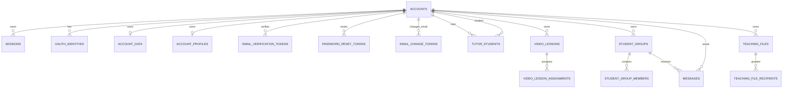

# Текущая структура базы данных Tandem

Этот документ описывает фактическую схему production-данных Worker на Cloudflare D1. Источник истины — миграции в [`cloudflare/migrations/`](../../cloudflare/migrations/). D1 совместим с SQLite: идентификаторы и JSON-документы хранятся как `TEXT`, а временные метки — как Unix time в секундах (`INTEGER`).

Это не описание отдельной PostgreSQL-схемы из `database/`. PostgreSQL и Java backend остаются независимой будущей архитектурой и пока не обслуживают данные работающего Worker.

## Состав и границы данных



`account_data.data_json` — единственный документ со значительной частью состояния кабинета: расписанием, заданиями, досками, планером и заметками. D1 не имеет отдельных реляционных таблиц для этих сущностей. Содержимое файлов не хранится в D1: метаданные записаны в таблицах, сами объекты находятся в приватном Workers KV namespace `HOMEWORK_FILES`.

## Таблицы аккаунта и авторизации

### `accounts`

Учётная запись. Создана миграцией `0001_auth.sql`, пароль добавлен в `0002_password_auth.sql`.

| Колонка | Тип | Ограничения и назначение |
|---|---|---|
| `id` | `TEXT` | PK; строковый идентификатор |
| `role` | `TEXT` | nullable, CHECK `tutor` или `student` |
| `name` | `TEXT` | NOT NULL |
| `email` | `TEXT` | nullable; уникален без учёта регистра, если не NULL |
| `email_verified` | `INTEGER` | NOT NULL, default `0` |
| `avatar_url` | `TEXT` | nullable |
| `plan` | `TEXT` | NOT NULL, default `light`; текущие значения приложения: `free`, `light`, `extreme` |
| `created_at` | `INTEGER` | NOT NULL, Unix seconds |
| `updated_at` | `INTEGER` | NOT NULL, Unix seconds |
| `password_hash` | `TEXT` | nullable; хранит только хеш пароля |

Индекс `accounts_email_unique_idx` — UNIQUE по `email COLLATE NOCASE`, исключая NULL. В SQL миграции нет CHECK для `plan`, `role` остаётся nullable до выбора роли.

### `oauth_identities`

OAuth-связи. Таблица сохранена в схеме, хотя миграция `0002_password_auth.sql` удаляла ранние строки при переходе на парольную авторизацию.

| Колонка | Тип | Ограничения |
|---|---|---|
| `provider` | `TEXT` | PK часть; CHECK `google`, `yandex`, `vk` |
| `provider_subject` | `TEXT` | PK часть |
| `account_id` | `TEXT` | NOT NULL, FK → `accounts.id` ON DELETE CASCADE; UNIQUE вместе с `provider` |
| `created_at` | `INTEGER` | NOT NULL |

PK: `(provider, provider_subject)`. Ограничение `UNIQUE(account_id, provider)` не допускает две identity одного провайдера для одного аккаунта.

### `sessions`

Сессии Worker, в которых хранится только SHA-256 хеш cookie-токена.

| Колонка | Тип | Ограничения |
|---|---|---|
| `token_hash` | `TEXT` | PK |
| `account_id` | `TEXT` | NOT NULL, FK → `accounts.id` ON DELETE CASCADE |
| `expires_at` | `INTEGER` | NOT NULL |
| `created_at` | `INTEGER` | NOT NULL |

Индексы: `sessions_account_id_idx(account_id)` и `sessions_expires_at_idx(expires_at)`.

### Одноразовые токены

Три таблицы используют хеш одноразового токена как PK и удаляются каскадно вместе с аккаунтом.

| Таблица | Дополнительные поля | Индексы |
|---|---|---|
| `email_verification_tokens` | `account_id`, `expires_at`, `created_at` | `email_verification_account_idx`, `email_verification_expiry_idx` |
| `password_reset_tokens` | `account_id`, `expires_at`, `created_at` | `password_reset_account_idx`, `password_reset_expiry_idx` |
| `email_change_tokens` | `account_id`, `new_email COLLATE NOCASE`, `expires_at`, `created_at` | UNIQUE `new_email` |

Все `account_id` — NOT NULL FK → `accounts.id` ON DELETE CASCADE. У `email_change_tokens` нет отдельного индекса срока действия.

## Профили и состояние кабинета

### `account_data`

| Колонка | Тип | Ограничения |
|---|---|---|
| `account_id` | `TEXT` | PK, FK → `accounts.id` ON DELETE CASCADE |
| `data_json` | `TEXT` | NOT NULL |
| `updated_at` | `INTEGER` | NOT NULL |

`data_json` — сериализованный JSON, который Worker сохраняет целиком. Его схема не ограничивается D1; сервер проверяет только размер payload. При чтении данных связанного ученика Worker формирует ограниченную проекцию уроков, заданий и досок из документа преподавателя.

### `account_profiles`

| Колонка | Тип | Ограничения |
|---|---|---|
| `account_id` | `TEXT` | PK, FK → `accounts.id` ON DELETE CASCADE |
| `profile_json` | `TEXT` | NOT NULL |
| `updated_at` | `INTEGER` | NOT NULL |

Хранит дополнительный профильный JSON отдельно от основного документа кабинета.

### `tutor_students`

Подтверждённая связь между преподавателем и учеником.

| Колонка | Тип | Ограничения |
|---|---|---|
| `tutor_id` | `TEXT` | PK часть, FK → `accounts.id` ON DELETE CASCADE |
| `student_id` | `TEXT` | PK часть, FK → `accounts.id` ON DELETE CASCADE |
| `created_at` | `INTEGER` | NOT NULL |

PK: `(tutor_id, student_id)`. Индекс: `tutor_students_student_id_idx(student_id)`. Роль участников в таблице не проверяется SQL-ограничением: это делает Worker.

## Видеоуроки

### `video_lessons`

| Колонка | Тип | Ограничения |
|---|---|---|
| `id` | `TEXT` | PK |
| `owner_id` | `TEXT` | NOT NULL, FK → `accounts.id` ON DELETE CASCADE |
| `title` | `TEXT` | NOT NULL |
| `provider` | `TEXT` | NOT NULL, CHECK `YouTube` или `Rutube` |
| `source_url` | `TEXT` | NOT NULL |
| `embed_url` | `TEXT` | NOT NULL |
| `created_at` | `INTEGER` | NOT NULL |
| `updated_at` | `INTEGER` | NOT NULL |

Индекс: `video_lessons_owner_idx(owner_id, updated_at DESC)`.

### `video_lesson_assignments`

| Колонка | Тип | Ограничения |
|---|---|---|
| `video_id` | `TEXT` | PK часть, FK → `video_lessons.id` ON DELETE CASCADE |
| `student_id` | `TEXT` | PK часть, FK → `accounts.id` ON DELETE CASCADE |
| `assigned_by` | `TEXT` | NOT NULL, FK → `accounts.id` ON DELETE CASCADE |
| `created_at` | `INTEGER` | NOT NULL |

PK: `(video_id, student_id)`. Индекс: `video_lesson_assignments_student_idx(student_id, created_at DESC)`.

## Группы и сообщения

### `student_groups`

| Колонка | Тип | Ограничения |
|---|---|---|
| `id` | `TEXT` | PK |
| `tutor_id` | `TEXT` | NOT NULL, FK → `accounts.id` ON DELETE CASCADE |
| `name` | `TEXT` | NOT NULL |
| `created_at` | `INTEGER` | NOT NULL |
| `updated_at` | `INTEGER` | NOT NULL |

Индекс: `student_groups_tutor_idx(tutor_id, updated_at DESC)`.

### `student_group_members`

| Колонка | Тип | Ограничения |
|---|---|---|
| `group_id` | `TEXT` | PK часть, FK → `student_groups.id` ON DELETE CASCADE |
| `student_id` | `TEXT` | PK часть, FK → `accounts.id` ON DELETE CASCADE |
| `created_at` | `INTEGER` | NOT NULL |

PK: `(group_id, student_id)`. Индекс: `student_group_members_student_idx(student_id, group_id)`.

### `messages`

| Колонка | Тип | Ограничения |
|---|---|---|
| `id` | `TEXT` | PK |
| `sender_id` | `TEXT` | NOT NULL, FK → `accounts.id` ON DELETE CASCADE |
| `recipient_id` | `TEXT` | nullable, FK → `accounts.id` ON DELETE CASCADE |
| `group_id` | `TEXT` | nullable, FK → `student_groups.id` ON DELETE CASCADE |
| `body` | `TEXT` | NOT NULL |
| `created_at` | `INTEGER` | NOT NULL |
| `attachments_json` | `TEXT` | NOT NULL, default `'[]'` |

CHECK требует ровно один адресат: либо `recipient_id`, либо `group_id`. Индексы: `messages_direct_idx(recipient_id, sender_id, created_at)` и `messages_group_idx(group_id, created_at)`. `attachments_json` добавлен миграцией `0007_file_library.sql`; D1 не проверяет, что JSON ссылается на существующие файлы.

## Файлы

### `homework_attachments` и `homework_attachment_recipients`

Это legacy-хранилище вложений домашней работы. Его маршруты оставлены для совместимости с уже созданными заданиями.

| Таблица | Колонки и ограничения |
|---|---|
| `homework_attachments` | `id` TEXT PK; `owner_id` TEXT NOT NULL FK → accounts CASCADE; `task_id` TEXT NOT NULL; `object_key` TEXT NOT NULL UNIQUE; `file_name`, `content_type` TEXT NOT NULL; `size_bytes` INTEGER NOT NULL; `created_at` INTEGER NOT NULL |
| `homework_attachment_recipients` | PK `(attachment_id, student_id)`; оба поля FK → attachment/accounts ON DELETE CASCADE |

Индексы: `homework_attachments_task_idx(owner_id, task_id, created_at)` и `homework_attachment_recipients_student_idx(student_id, attachment_id)`. `task_id` — строка без FK, потому что задания находятся в `account_data.data_json`.

### `teaching_files` и `teaching_file_recipients`

Переиспользуемая библиотека файлов преподавателя.

| Таблица | Колонки и ограничения |
|---|---|
| `teaching_files` | `id` TEXT PK; `owner_id` TEXT NOT NULL FK → accounts CASCADE; `object_key` TEXT NOT NULL UNIQUE; `file_name`, `content_type` TEXT NOT NULL; `size_bytes` INTEGER NOT NULL; `folder_name` TEXT NOT NULL default `''`; `created_at` INTEGER NOT NULL |
| `teaching_file_recipients` | PK `(file_id, student_id)`; оба поля FK → teaching_files/accounts ON DELETE CASCADE |

Индексы: `teaching_files_owner_idx(owner_id, created_at DESC)` и `teaching_file_recipients_student_idx(student_id, file_id)`.

Worker применяет ограничение размера файла 10 MiB и проверяет владельца и связь преподаватель–ученик до выдачи доступа. Эти правила находятся в приложении, а не в SQL-ограничениях D1.

## Ограничение демонстрации экрана

### `room_screen_shares`

Атомарная аренда демонстрации экрана для бесплатного тарифа.

| Колонка | Тип | Ограничения |
|---|---|---|
| `room_id` | `TEXT` | PK |
| `account_id` | `TEXT` | NOT NULL, FK → `accounts.id` ON DELETE CASCADE |
| `expires_at` | `INTEGER` | NOT NULL |
| `updated_at` | `INTEGER` | NOT NULL |

Одна строка на комнату. Worker обновляет аренду, только если текущая истекла или уже принадлежит тому же аккаунту.

## История миграций

| Миграция | Изменение |
|---|---|
| `0001_auth.sql` | аккаунты, OAuth identities, сессии, документ кабинета |
| `0002_password_auth.sql` | удаление ранних sample-данных; пароли, email verification и password reset |
| `0003_tutor_students.sql` | связи преподавателей и учеников |
| `0004_account_profiles.sql` | профильный JSON и смена email |
| `0005_video_lessons.sql` | видеоуроки и назначения ученикам |
| `0006_collaboration.sql` | группы, сообщения, legacy-вложения домашней работы |
| `0007_file_library.sql` | библиотека файлов, message attachments и аренды screen share |

Перед production deploy D1-миграции применяются отдельно от Worker:

```sh
npx wrangler d1 migrations apply tandem-auth --remote --config wrangler.jsonc
```

Новые изменения схемы добавляются только новой последовательной миграцией. Уже применённые SQL-файлы не редактируются.
