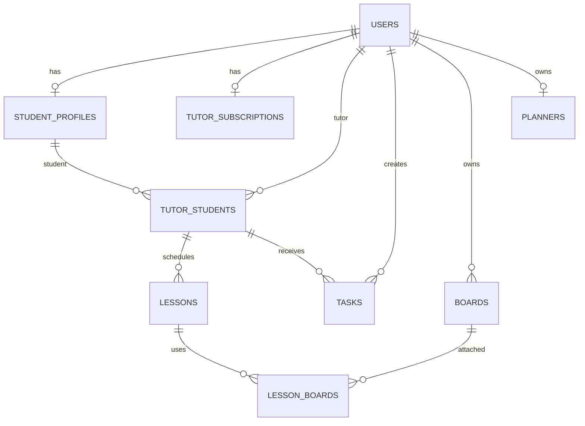

# Целевая структура базы данных Tandem

Этот документ описывает проектируемую серверную БД для перехода от локального демо к многопользовательскому приложению. Схема ниже — предложение для реализации, а не описание уже подключённой БД. Она рассчитана на PostgreSQL: в проекте пока нет БД, миграций или драйвера.

## Принятые решения

- `users` — учётные записи и аутентификация; `student_profiles` — профиль ученика. У пользователя одна роль (`tutor` или `student`); репетиторский тариф хранится отдельно.
- Ученик может работать с несколькими репетиторами. Связь и заметки/прогресс конкретного преподавателя вынесены в `tutor_students`.
- Предмет и уровень ученика хранятся на связи с репетитором: разные преподаватели могут заниматься разными предметами/уровнями. Это соответствует тому, что сейчас карточка ученика смешивает эти данные с личным профилем.
- Урок принадлежит паре репетитор–ученик. Составной внешний ключ гарантирует, что нельзя создать урок для несвязанной пары.
- Доска может использоваться несколькими уроками. Связь хранится только в `lesson_boards`, без дублирования `boardId` и массива `lessonIds`.
- Личная задача не имеет ученика; домашняя работа обязательно имеет ученика. Это фиксируется CHECK-ограничением.
- Времена уроков хранятся как `timestamptz` (момент времени), а не как раздельные дата и локальное время. Клиент должен передавать ISO 8601 с часовым смещением.
- Внутренние элементы доски и планера пока хранятся JSONB: приложению нужны целые документы, запросов по отдельным элементам нет.

## ER-диаграмма



## Таблицы

### `users`

Идентичность пользователя; пароль/провайдер OAuth и сессии управляются backend, не браузерным state.

| Колонка | Тип PostgreSQL | Ограничения |
|---|---|---|
| `id` | `uuid` | PK, `gen_random_uuid()` |
| `email` | `citext` | NOT NULL, UNIQUE |
| `display_name` | `text` | NOT NULL, длина 1–120 |
| `role` | `text` | NOT NULL, CHECK `tutor` или `student` |
| `created_at` | `timestamptz` | NOT NULL, default `now()` |
| `updated_at` | `timestamptz` | NOT NULL, default `now()` |

Email нормализуется и сравнивается без учёта регистра (`citext`; либо `lower(email)` unique index, если расширение не используется). Секреты аутентификации не добавляются в эту таблицу открытым текстом. Для OAuth лучше завести отдельную `auth_identities` с уникальной парой `(provider, provider_subject)`.

### `student_profiles`

| Колонка | Тип PostgreSQL | Ограничения |
|---|---|---|
| `user_id` | `uuid` | PK, FK → `users.id` ON DELETE CASCADE |
| `grade_label` | `text` | NULL, длина до 80 |
| `created_at` | `timestamptz` | NOT NULL, default `now()` |
| `updated_at` | `timestamptz` | NOT NULL, default `now()` |

Строка профиля существует только у пользователя с ролью `student`. Проверка соответствия роли находится в транзакционной логике/триггере, поскольку CHECK не может ссылаться на другую таблицу. Имя и email берутся из `users`, поэтому не дублируются.

### `tutor_subscriptions`

| Колонка | Тип PostgreSQL | Ограничения |
|---|---|---|
| `tutor_id` | `uuid` | PK, FK → `users.id` ON DELETE CASCADE |
| `plan_code` | `text` | NOT NULL, CHECK `light` или `extreme` |
| `status` | `text` | NOT NULL, CHECK `active`, `trialing`, `past_due`, `canceled` |
| `period_ends_at` | `timestamptz` | NULL |
| `created_at` | `timestamptz` | NOT NULL, default `now()` |
| `updated_at` | `timestamptz` | NOT NULL, default `now()` |

Для первой версии это состояние тарифа, не платёжный журнал. Оно допустимо только для пользователя `role=tutor`.

### `tutor_students`

Пара «репетитор ведёт ученика» и все учебные данные, специфичные для этой пары.

| Колонка | Тип PostgreSQL | Ограничения |
|---|---|---|
| `tutor_id` | `uuid` | PK часть; FK → `users.id` |
| `student_id` | `uuid` | PK часть; FK → `student_profiles.user_id` |
| `subject` | `text` | NOT NULL, длина 1–120 |
| `grade_label` | `text` | NULL, длина до 80 |
| `private_note` | `text` | NOT NULL, default `''` |
| `progress_percent` | `smallint` | NOT NULL, default 0, CHECK 0–100 |
| `status` | `text` | NOT NULL, CHECK `active` или `archived` |
| `created_at` | `timestamptz` | NOT NULL, default `now()` |
| `updated_at` | `timestamptz` | NOT NULL, default `now()` |

PK `(tutor_id, student_id)`. Удаление связи ограничивается, если на ней есть история, либо выполняется архивирование; физическое удаление пользователя каскадно удалит данные только согласно явной политике retention.

### `boards`

| Колонка | Тип PostgreSQL | Ограничения |
|---|---|---|
| `id` | `uuid` | PK, `gen_random_uuid()` |
| `owner_tutor_id` | `uuid` | NOT NULL, FK → `users.id` |
| `name` | `text` | NOT NULL, длина 1–160 |
| `elements` | `jsonb` | NOT NULL, default `[]`, CHECK JSON array |
| `created_at` | `timestamptz` | NOT NULL, default `now()` |
| `updated_at` | `timestamptz` | NOT NULL, default `now()` |

У доски один владелец-репетитор; приложению следует проверять размер JSON и версию формата элементов. `updated_at` обновляется сервером.

### `lessons`

| Колонка | Тип PostgreSQL | Ограничения |
|---|---|---|
| `id` | `uuid` | PK, `gen_random_uuid()` |
| `tutor_id` | `uuid` | NOT NULL |
| `student_id` | `uuid` | NOT NULL |
| `title` | `text` | NOT NULL, длина 1–200 |
| `starts_at` | `timestamptz` | NOT NULL |
| `duration_minutes` | `smallint` | NOT NULL, CHECK 15–240 |
| `status` | `text` | NOT NULL, CHECK `scheduled`, `in_progress`, `completed`, `canceled`, `no_show` |
| `created_at` | `timestamptz` | NOT NULL, default `now()` |
| `updated_at` | `timestamptz` | NOT NULL, default `now()` |

FK `(tutor_id, student_id)` → `tutor_students(tutor_id, student_id)`. Для календаря индекс `(tutor_id, starts_at)` и `(student_id, starts_at)`. Пересечение расписаний лучше проверять в транзакции; при необходимости запрета пересечений на уровне БД можно добавить exclusion constraint с диапазоном времени.

### `lesson_boards`

| Колонка | Тип PostgreSQL | Ограничения |
|---|---|---|
| `lesson_id` | `uuid` | PK часть, FK → `lessons.id` ON DELETE CASCADE |
| `board_id` | `uuid` | PK часть, FK → `boards.id` ON DELETE RESTRICT |
| `attached_at` | `timestamptz` | NOT NULL, default `now()` |

PK `(lesson_id, board_id)`. Несколько уроков могут использовать одну доску, и к одному уроку можно прикрепить несколько досок. Если продукт решит, что у урока только одна активная доска, добавить UNIQUE по `lesson_id`.

### `tasks`

| Колонка | Тип PostgreSQL | Ограничения |
|---|---|---|
| `id` | `uuid` | PK, `gen_random_uuid()` |
| `tutor_id` | `uuid` | NOT NULL, FK → `users.id` |
| `student_id` | `uuid` | NULL |
| `kind` | `text` | NOT NULL, CHECK `personal` или `homework` |
| `title` | `text` | NOT NULL, длина 1–200 |
| `description` | `text` | NOT NULL, default `''` |
| `subject` | `text` | NULL, длина до 120 |
| `due_at` | `timestamptz` | NULL |
| `status` | `text` | NOT NULL, CHECK `todo`, `submitted`, `complete` |
| `created_at` | `timestamptz` | NOT NULL, default `now()` |
| `updated_at` | `timestamptz` | NOT NULL, default `now()` |

CHECK: `(kind = 'personal' AND student_id IS NULL AND status IN ('todo','complete')) OR (kind = 'homework' AND student_id IS NOT NULL)`. FK `(tutor_id, student_id)` → `tutor_students`; для personal с NULL FK не применяется. Индексы: `(tutor_id, status, due_at)` и `(student_id, status, due_at)`.

### `planners`

| Колонка | Тип PostgreSQL | Ограничения |
|---|---|---|
| `owner_tutor_id` | `uuid` | PK, FK → `users.id` ON DELETE CASCADE |
| `title` | `text` | NOT NULL, default `План на неделю`, длина до 160 |
| `blocks` | `jsonb` | NOT NULL, default `[]`, CHECK JSON array |
| `created_at` | `timestamptz` | NOT NULL, default `now()` |
| `updated_at` | `timestamptz` | NOT NULL, default `now()` |

Планер ученика сейчас не является отдельным продуктовым сценарием. Не создавайте запись для произвольного ключа `student-planner`; если появится личный планер ученика, замените владельца на общий `owner_user_id`.

## SQL-ограничения и индексы (сводка)

```sql
-- Расширение нужно для нечувствительного к регистру email.
CREATE EXTENSION IF NOT EXISTS citext;

-- Существенные связи/ограничения; поля таблиц см. выше.
ALTER TABLE tutor_students ADD PRIMARY KEY (tutor_id, student_id);
ALTER TABLE lessons ADD CONSTRAINT lessons_tutor_student_fk
  FOREIGN KEY (tutor_id, student_id)
  REFERENCES tutor_students (tutor_id, student_id) ON DELETE RESTRICT;
ALTER TABLE lesson_boards ADD PRIMARY KEY (lesson_id, board_id);
ALTER TABLE tasks ADD CONSTRAINT tasks_tutor_student_fk
  FOREIGN KEY (tutor_id, student_id)
  REFERENCES tutor_students (tutor_id, student_id) ON DELETE RESTRICT;
CREATE INDEX lessons_tutor_schedule_idx ON lessons (tutor_id, starts_at);
CREATE INDEX lessons_student_schedule_idx ON lessons (student_id, starts_at);
CREATE INDEX tasks_tutor_status_due_idx ON tasks (tutor_id, status, due_at);
CREATE INDEX tasks_student_status_due_idx ON tasks (student_id, status, due_at);
CREATE INDEX boards_owner_updated_idx ON boards (owner_tutor_id, updated_at DESC);
```

Блок SQL показывает только ключевые ограничения и индексы, не является полной миграцией; перед созданием миграций типы ролей/статусов можно оформить PostgreSQL ENUM, но `text + CHECK` проще менять при развитии продукта.

## Валидация, транзакции и доступ

- Backend обязан валидировать длины, диапазоны, допустимые статусы и формат JSON до записи; ограничения БД остаются последней линией защиты.
- Все операции изменения связанных данных выполняются транзакционно. Например, добавление ученика и `tutor_students`, создание урока и прикрепление доски.
- Проверка доступа должна использовать ID пользователя из серверной сессии, а не присланный клиентом `tutor_id`. Репетитор видит только свои связи, уроки, задачи и доски; ученик — только собственные задания и уроки.
- Для `tutor_students`, `lessons`, `tasks`, `boards` предпочтительно архивирование/soft delete там, где нужна история. Не добавлять каскадное физическое удаление истории случайно.
- Частые выборки расписания/заданий покрыты индексами выше. JSONB для доски/планера сохраняется атомарно с optimistic locking (например, `updated_at` или `version`), чтобы параллельные изменения не перетирали друг друга.

## Миграция текущих demo-данных

Старые ID строковые и генерируются через `Date.now()`, поэтому при переносе их следует сопоставить с UUID и хранить таблицу отображения только на время импорта. `accounts` превращаются в `users`; записи учеников связываются через `student_profiles`; `tutorLinks` становятся `tutor_students`; `lessons` и `tasks` получают реальные FK; `boards.lessonIds` и `lessons.boardId` сводятся в `lesson_boards`; `plannerByTutor` — в `planners`. Значения счетчика `students.lessons` в текущей модели выглядят отдельным кэшем/демо-полем: число завершённых занятий следует вычислять из `lessons`, если продукту не нужна ручная корректировка.

Переход требует отдельного решения по учётным данным: локальные демо-аккаунты не содержат безопасных паролей или подтверждённой OAuth-идентичности и напрямую не должны становиться production-учётками.
